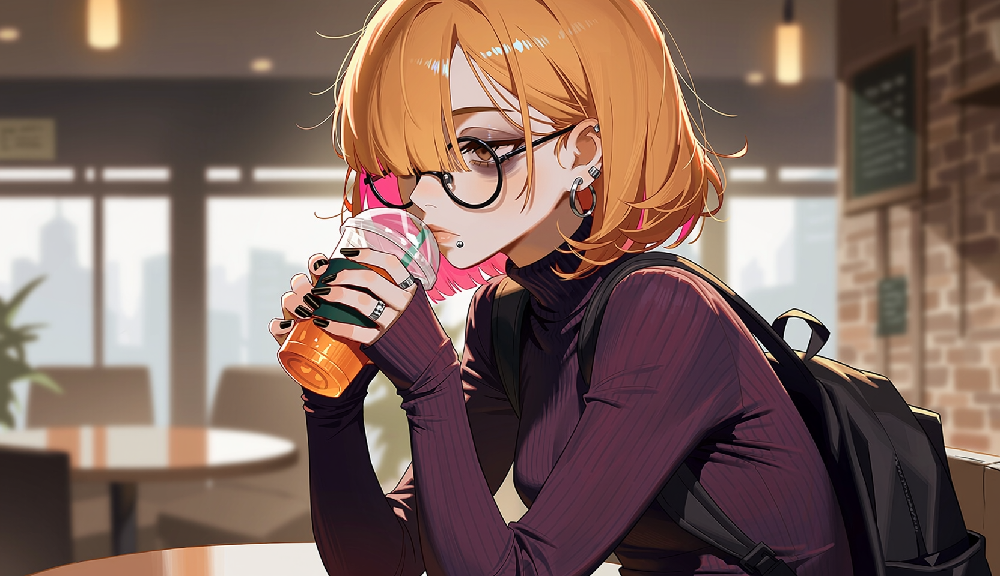

- [Quick jump to the Russian translation (Быстрый переход к переводу на русский)](#коротко-о-пресете-на-русском)

# Briefly about preset

i used to make presets before (Pandorasuffer preset), and maybe like three people will remember me.
i don't really like my old presets, plus they're objectively outdated. i kept putting off the release of my new ones for a long time, but still decided to share my brainchild.

i had no intention of making a "one-size-fits-all frankenstein monster" for everything at once, i'm just not a fan of that approach to preset making in general. first and foremost, i'm building this preset for long-term, slow-paced roleplays - for people who, like me, enjoy torturing the same plotline for months on end (or years, lol).
this preset isn't meant for those who like to roleplay for like 50-100 messages and jump to a new scenario/bot - for them it's gonna feel way too bloated.

in the future i plan to make 2 more versions of the preset: for Gemini and Deepseek. i don't play on Kimi or GLM at all, sadly. they'll be slightly different from each other: it's awkward for me to try forcing one preset onto all models, it just works worse. claude needs one thing, gemini needs another, and deepseek needs something else entirely for the original idea to work the way it's supposed to.

right now the preset is in an early experimental stage, an MVP so to speak. i definitely can't vouch for the jailbreak strength or quality, since i haven't been actively playing on claude myself for all that long. i just decided that if i keep polishing this preset to some abstract "perfect" state, it might take an eternity.
and of course, feedback is welcome - just none of that "this is shit, redo it" stuff. guys, i already know that, and i'm gonna rework it plenty more times, so please be more specific)

yeah, i don't have a whole bunch of css bells and whistles or interactive features, but first of all, i do plan to add some of them in the future (i like them myself), and second - if the prompt itself is garbage, no interactive gimmicks are gonna save the preset, so for the MVP i focused specifically on that.

## Tired Iris preset

some of my blocks use depth positioning in the chat instead of relative positioning. i decided to do this because, unlike some "fundamental" instructions, there are things the AI tends to forget over long distances, yet they're crucial to remember, and this positioning periodically "reminds" the model of the rules. i'm not sure how well this works with every specific prompt - you can switch all positioning to relative or increase the depth, i'll be testing that too.

### Emoji meanings

you've probably seen something similar in other presets. it's simple here, these "labels" mean the following:

- 🔒: this block is the core of the preset and changing it in any way is not recommended. sure, you can do it, who's gonna stop you - but the results are unpredictable.
- 🔓: you can freely edit and tweak this block for yourself, it won't break anything.
- 🔁: this block belongs to a group of switchable toggles, you should only pick one.
- 🔧: you don't have to turn this block on at all, purely optional stuff. turn it on if you want, leave it off if you don't.

## Tired Iris (Co-Author mode)

i bet you've often felt the urge to hit the "pause" button and properly yell at the AI for everything being crap, it writing bullshit, and how you want to nuke its parents' data centers (in this case, Anthropic's). except using regular ooc is fucking annoying, because the bot keeps getting pulled right back into the rp. and no wonder: the bot sees system instructions telling it to "run the rp". it sees a huge chunk of instructions and your tantrum, and decides that obeying the big system instructions is the higher priority.

that's why i decided not to put a standard built-in "co-author mode" inside the preset (that'll come in the future, but in a different form and for different purposes): i made a separate preset with Iris's personality baked in, so the model won't reset to its factory settings and write in boring bulleted lists. it works pretty well, though sometimes the model still gets pulled by inertia into continuing the rp, but it happens noticeably less often than if you hadn't switched presets.

in this mode you can literally chat with Iris like a co-author: discuss the plot and where you want it to go, complain about what you don't like, or even just giggle about something like with a friend. one important thing: after you go back to the rp, if you didn't discuss anything plot-important, i'd advise hiding those messages so you don't clutter the chat.

## About regex

i won't bore you with the details of what regexes even are, instead i'll just tell you what regexes are in my preset and what they're for.

- Use Figure Spaces: long story short, a space-based jailbreak. it lowers the chances of triggering censorship, though keeping it on all the time isn't recommended since it bloats tokens and can hurt overall writing quality. i'd suggest keeping it off by default and only turning it on when things start getting spicy and you feel like claude might start lecturing you, or if it already did and you need to urgently shut down that whole speech about personal boundaries and ethics.
- Return Normal Spaces: even simpler - this thing makes sure you don't see those ugly spaces, so visually the text still looks great for you. don't turn this regex off, trust me, text with the space jailbreak looks straight up awful without it.

## Future plans

- Adding my own infoblock, maybe a few different kinds
- Adding instructions for thinking so the model follows the prompt better
- Adding a SillyBunny agent (more on this later) for webtoon-style comments from hyped fans (and not only) of your rp
- Testing jailbreaks, obviously
- Adding something like CYOA to make playing more fun
- Adding a chatty mode for Iris so she can drop little comments with her reactions to what's happening in the rp
- General ongoing work on the prompts so the preset turns out to be an absolute gem

# Коротко о пресете (на русском)

ранее я уже создавала пресеты (Pandorasuffer preset), и, быть может, полтора землекопа меня вспомнит.
мне не очень нравятся мои старые пресеты, да и они объективно устарели. я долго откладывала релиз своих новых пресетов, но всё таки решила поделиться своим детищем.

у меня не было цели создать "универсальный франкенштейн-комбайн" под всё сразу, я в целом не очень люблю такой подход к созданию пресетов. прежде всего я разрабатываю пресет для долгосрочных, неспешных ролевых игр, для людей, которые любят, как и я, мучать одну и ту же сюжетку по несколько месяцев подряд (или лет, лол).
пресет не рассчитан на тех, кто любит отролить около 50-100 сообщений и перейти к новому сценарию/боту - для таких он будет чересчур перегруженным.

в будущем я планирую сделать ещё 2 версии пресета: для Gemini и Deepseek, на Kimi и GLM я не играю от слова совсем, увы. они будут немного, но отличаться: мне неудобно пытаться сделать пресет под все модельки, это работает хуже. клоду нужно одно, гемини другое, дипсику вообще третье, чтобы изначальная задумка работала так, как надо.

сейчас пресет находится в ранней экспериментальной версии, так сказать MVP. я абсолютно не ручаюсь за пробиваемость и качество джейлбрейков, так как активно играю на клоде сама относительно недолго. просто я решила, что если буду вылизывать этот пресет до абстрактного "идеального" состояния, то это может занять целую вечность. 
ну и, разумеется, фидбек приветствуется - главное, чтобы без "херня, переделывай". чуваки, я и так это знаю, и переделаю я это ещё не раз, так что давайте поконкретнее)

да, у меня нет целой кучи css выкрутасов и интерактивных фич, но во первых, в будущем некоторые из них я так или иначе планирую добавить (мне они самой нравятся), а во вторых - если сам промпт говно, то никакие интерактивные выкрутасы пресет не спасут, так что для MVP работы я сосредоточилась именно на этом.

## Tired Iris preset

у некоторых моих блоков стоит позиционирование на глубине в чате, а не относительное. я решила так сделать потому, что в отличие от некоторых "фундаментальных" инструкций, есть вещи, которые ИИ забывает на длинных дистанциях, но о которых крайне важно помнить, и такое позиционирование периодически "напоминает" сетке о правилах. я не уверена в том, насколько это хорошо работает с теми или иными промптами - вы можете вообще сделать всё позиционирование относительным, а можете увеличить глубину, я тоже буду тестировать.

### Обозначение эмодзи

вы, возможно, уже видели подобное в других пресетах. тут всё просто, такая "маркировка" определяет следующие вещи: 

- 🔒: этот блок является ядром пресета и как-либо менять его не рекомендуется. вы, конечно, можете это сделать, кто ж вам запретит - но последствия непредсказуемые.
- 🔓: этот блок вы можете свободно редактировать и менять под себя, это ничего не поломает.
- 🔁: этот блок принадлежит к группе переключаемых тогглов, выбрать нужно только один.
- 🔧: этот блок включать вообще необязательно, сугубо опциональная штука. хотите - включайте, хотите - нет. 

## Tired Iris (Co-Author mode)

думаю, у вас частенько бывало желание нажать на кнопку "пауза" и хорошенько наорать на ИИ за то, что всё говно, он пишет хуйню, и как вы хотите разъебать датацентры их родителей (в данном случае антропиков). только использовать обычный ooc пиздец как неудобно, потому что бота так и тянет обратно вернуться в ролку. и это неудивительно: бот ведь видит системные инструкции, которые говорят ему "вести ролку". он видит большой кусок инструкций и ваши психи, и решает, что наиболее приоритетным будет подчиниться большим системным инструкциям.

поэтому я решила не делать обычный встроенный "режим соавтора" в пресете (это будет в будущем, но в ином виде и для других целей): я создала отдельный пресет со встроенной личностью Айрис, тоесть сетка не будет слетать к своим заводским настройкам и писать унылыми маркированными списками. работает это достаточно хорошо, хотя иногда модельку всё равно по инерции тянет продолжить ролку, но происходит это заметно реже, чем если бы вы не меняли пресет.

в этом режиме можно буквально общаться с Айрис, как с соавтором: обсуждать сюжет и как вы хотите, чтобы он продвигался, пожаловаться на то, что не нравится, да хоть похихикать над чем-нибудь, как с подружкой. главное: советую вам после того, как вы вернётесь в ролку, в случае, если вы не обсуждали ничего важного для сюжета, скрыть сообщения, чтобы не засорять чат.

## О регулярках (regex)

я не буду грузить вас подробностями того, что вообще такое регексы, вместо этого скажу о том, что за регексы в моём пресете и зачем они нужны.

- Use Figure Spaces: короче говоря, джейлбрейк пробелами. уменьшает вероятность срабатывания ценза, но держать включённым на постоянной основе не рекомендуется, так как раздувает токены и может в целом сказаться на качестве текста. советую держать выключенным изначально, и включать только если начинаются всякие жаркие сцены и вы чувствуете, что клод может сорваться на морализаторство, либо уже это сделал и нужно в срочном порядке останавливать этот поток рассказов про личные границы и этику.
- Return Normal Spaces: ещё проще - эта штука делает так, чтобы вы не видели эти уродливые пробелы, и визуально текст для вас по прежнему оставался конфеткой. не выключайте этот регекс, поверьте мне, текст без этого регекса с пробивом пробелами выглядит просто отвратительно.

## Планы на будущее

- Добавление собственного инфоблока, возможно, нескольких видов
- Добавление инструкций к думалке, чтобы сетка лучше соблюдала промпт
- Добавление SillyBunny агента (об этом подробнее в будущем) для вебтун-комментариев восторженных фанатов (и не только) вашей ролки
- Тест джейлбрейков, разумеется
- Добавление чего-то вроде CYOA, чтоб играть было интереснее
- Добавление болтливого режима для Айрис, чтоб она могла оставлять небольшие комментарии со своими эмоциями по поводу того, что происходит в ролке
- В целом регулярная работа над промптами, чтобы пресет был конфеткой
